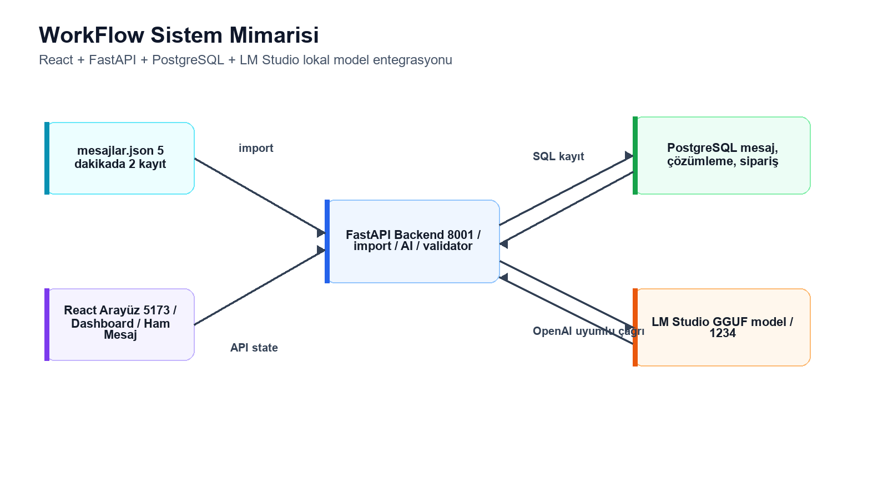
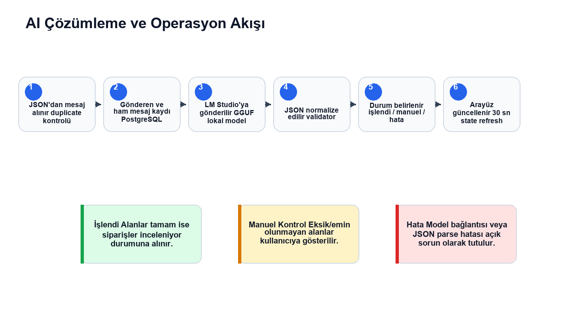
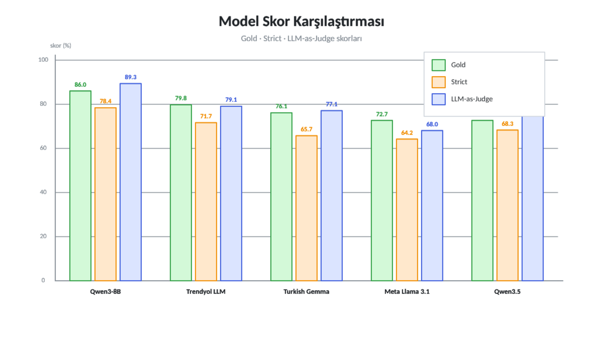
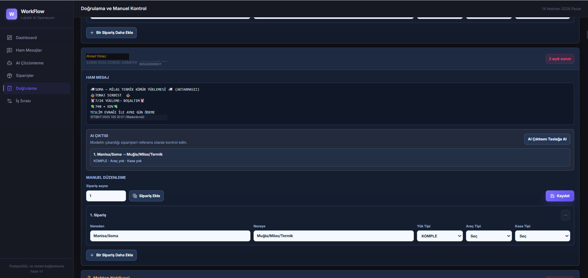
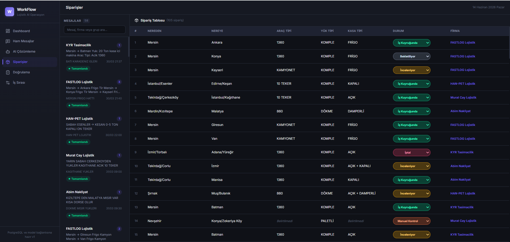
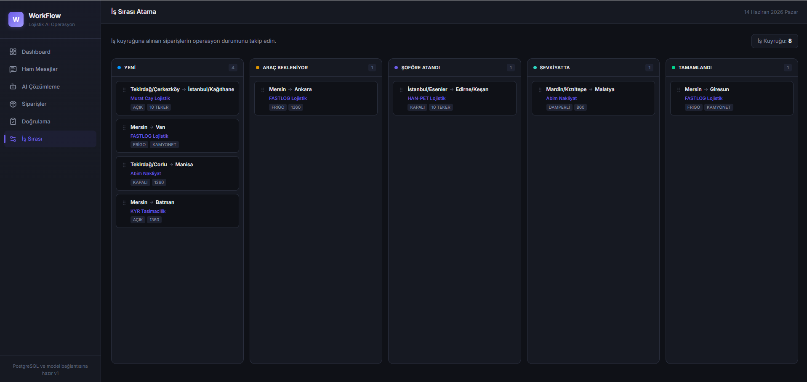
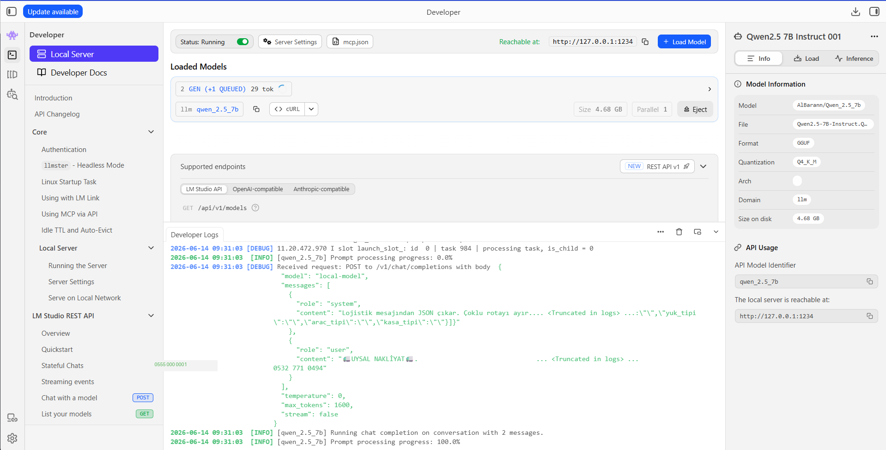

# 🚚 Türkçe Lojistik Mesajlarının Büyük Dil Modeli (LLM) ile Yapılandırılması ve Web Tabanlı Operasyon Sistemine Entegrasyonu

[](https://www.python.org/)
[](https://fastapi.tiangolo.com/)
[](https://react.dev/)
[](https://vitejs.dev/)
[](https://www.postgresql.org/)
[](https://pytorch.org/)
[](https://huggingface.co/)

> 🎓 **Fırat Üniversitesi Bilgisayar Mühendisliği Bölümü Lisans Bitirme Projesi**  
> **Geliştirici:** **Ali BARAN**  
> **Dönem:** 2026

---

## 📌 Proje Özeti ve Çözülen Problem

Karayolu lojistik sektöründe yük ve araç eşleştirme talepleri; çoğunlukla WhatsApp, Telegram ve nakliye platformlarındaki anlık mesajlaşma gruplarında serbest metin, yoğun kısaltmalar, bölgesel terminoloji ve standart dışı ifadelerle paylaşılmaktadır. Operasyon ekipleri bu mesajları manuel olarak okumakta; bu durum ciddi iş gücü kaybına, gecikmelere ve hatalı eşleşmelere yol açmaktadır.

Bu proje; serbest metin halindeki Türkçe lojistik mesajlarını **Büyük Dil Modelleri (LLM)** ve **QLoRA tabanlı ince ayar (Fine-Tuning)** ile işleyerek, doğrulanmış ve ilişkisel veri tabanına kaydedilebilir standart **JSON sipariş kayıtlarına** dönüştüren uçtan uca bir sistem sunar.

---

## 💡 Sistem Nasıl Çalışıyor? (Canlı Örnek: Girdi ➡️ Çıktı)

Repoyu inceleyen herkesin sistemin temel işlevini ilk bakışta anlayabilmesi için somut bir dönüşüm örneği:

### 📥 1. Girdi: Ham / Dağınık WhatsApp Lojistik Mesajı
```text
🚛 Mersin -> Batman 🚛
Yük: 20 Ton kasa içi makina
Araç Tipi: Açık 1360
Yükleme: Sabah 
Fiyat: 38 + KDV
İletişim: 0555 100 20 01 — Alfa Taşımacılık
```

### ⚙️ 2. İşlem: LLM Çıkarımı + Kural Tabanlı Doğrulama (Validator Engine)
* Metindeki rota ayrıştırılır: `Mersin` (Çıkış) ve `Batman` (Varış).
* Yük tipi makina/ekipman bağlamından standart sözlüğe dönüştürülür: `YÜKÜSTÜ`.
* Araç ve kasa tipi lojistik sınıflarına haritalanır: `1360` ve `AÇIK`.
* Çıktı sözdizimsel ve şema tutarlılığı denetiminden geçer.

### 📤 3. Çıktı: Standart ve Doğrulanmış JSON Sipariş Nesnesi
```json
{
  "siparis_sayisi": 1,
  "siparisler": [
    {
      "nereden": "Mersin",
      "nereye": "Batman",
      "yuk_tipi": "YÜKÜSTÜ",
      "arac_tipi": "1360",
      "kasa_tipi": "AÇIK"
    }
  ]
}
```
*Bu JSON verisi, arka planda PostgreSQL veritabanındaki `siparisler` tablosuna otomatik olarak işlenir ve operasyon yöneticisinin React panelinde listelenir.*

---

## 📑 İçindekiler
- [Neden Bu Modeli Seçtim? (Model Seçim Gerekçesi)](#-neden-bu-modeli-seçtim-model-seçim-gerekçesi)
- [Sistem Mimarisini Nasıl Kurdum?](#-sistem-mimarisini-nasıl-kurdum)
- [Neye Göre Başarılı Sayıldı? (Değerlendirme Metrikleri)](#-neye-göre-başarılı-sayıldı-değerlendirme-metrikleri)
- [Ekran Görüntüleri ve Arayüz](#-ekran-görüntüleri-ve-arayüz)
- [Teknoloji Yığını](#-teknoloji-yığını)
- [Klasör Yapısı](#-klasör-yapısı)
- [Veri Gizliliği ve KVKK Notu](#-veri-gizliliği-ve-kvkk-notu)
- [Kurulum ve Çalıştırma Rehberi](#-kurulum-ve-çalıştırma-rehberi)
- [Geliştirici & Lisans](#-geliştirici--lisans)

---

## 🧠 Neden Bu Modeli Seçtim? (Model Seçim Gerekçesi)

Proje kapsamında **7 farklı açık kaynaklı dil modeli** (Qwen 2.5, Llama 3/3.1, Turkish LLM YTU-CE, Mistral vb.) benchmark testlerine tabi tutulmuş ve nihai üretim modeli olarak **Qwen 2.5 (7B/14B)** tercih edilmiştir. Bu kararın temel teknik gerekçeleri:

1. **Üstün Yapılandırılmış JSON Üretimi:** Qwen 2.5 ailesi, karmaşık sistem istemlerini (system prompts) ve katı JSON şeması kısıtlamalarını diğer modellere göre çok daha kararlı takip edebilmektedir (JSON syntax ihlali oranı %0).
2. **Türkçe Morfolojik ve Anlamsal Başarı:** Türkçe eklemeli dil yapısı ve nakliye argosundaki bölgesel kısaltmaları (örn: *kısa dorse, 10 teker, parsiyel, yüküstü, sac kasa*) bağlamdan çıkarma yeteneği en yüksek model olmuştur.
3. **Alternatifli İfadeleri Koruma Yeteneği:** Lojistikte çok sık karşılaşılan *"açık/kapalı fark etmez"*, *"frigo veya tente uyar"* gibi seçenekleri modelin `AÇIK + KAPALI` şeklinde çoklu sınıf olarak koruma başarısı Qwen 2.5'te en yüksektir.
4. **Yerel Donanım ve Kaynak Verimliliği:** QLoRA (4-bit NF4) kuantizasyonu sayesinde tüketici seviyesi 12-16 GB VRAM'e sahip yerel kartlarda (veya LM Studio üzerinde) harici API maliyeti olmadan sıfır gecikmeyle çalıştırılabilmektedir.

---

## 🏛️ Sistem Mimarisini Nasıl Kurdum?

Sistem, yapay zekânın doğrudan kontrolsüz karar almasını engelleyen ve **insan denetimini (Human-in-the-Loop)** merkeze alan 3 katmanlı gevşek bağlı bir mimariyle tasarlanmıştır:

### Uçtan Uca Sistem Mimarisi


### Mesajdan Siparişe İş Akışı


### Temel Tasarım İlkeleri:
1. **İki Aşamalı Validasyon (Validation Layer):** LLM çıktısı asla doğrudan operasyon veritabanına kaydedilmez. `backend/app/validator.py` motoru çıktıyı:
   * Şema geçerliliği (Pydantic),
   * Şehir/ilçe coğrafi tutarlılığı,
   * Standart lojistik terim sözlüğü kontrolünden geçirir.
2. **Kuyruk ve Hata Yönetimi:** Doğrulamadan geçemeyen şüpheli mesajlar sistem tarafından reddedilmek yerine **"Manuel Kontrol Kuyruğu"**na yönlendirilir; operatör tek tıkla düzeltebilir.
3. **Model İstemci Soyutlaması (`model_client.py`):** Kod tabanı tek bir modele bağımlı değildir; ister yerel **LM Studio**, ister bağımsız **Model Worker**, ister test amaçlı **Mock Modu** tek bir ortam değişkeniyle (`MODEL_CLIENT_MODE`) değiştirilebilir.

---

## 📊 Neye Göre Başarılı Sayıldı? (Özel Lojistik Değerlendirme Motoru - evaluate.py)

Lojistik sektöründeki serbest metinli mesajlar; yoğun argo, bölgesel kısaltmalar, karmaşık rota kombinasyonları ve alternatif araç/kasa opsiyonları içerir. Bu nedenle **standart NLP metrikleri (Exact Match, BLEU, ROUGE vb.) bu problemde tamamen yetersiz kalmaktadır.**

Örneğin; altın standartta (Ground Truth) kasa tipi `AÇIK + KAPALI` iken, model `KAPALI + AÇIK` ürettiğinde standart metin karşılaştırması bunu başarısız (0 puan) sayar. Benzer şekilde `13.60`, `1360` ve `TIR` ifadeleri veya `TENTE` ile `KAPALI` ifadeleri sektörde aynı anlama gelir.

Bu sorunu çözmek ve modellerin başarısını adil, matematiksel ve sektöre uygun şekilde ölçmek için **özel bir değerlendirme motoru (`benchmark/evaluate.py`)** geliştirilmiş ve modeller çoklu test iterasyonlarına tabi tutulmuştur:



### ⚙️ Geliştirilen Değerlendirme Motorunun 5 Temel Bileşeni:

1. **Permütasyondan Bağımsız Çoklu Alternatif Eşleme (`+` Operatörü):**
   * Nakliyecilerin sıkça kullandığı *"açık/kapalı fark etmez"* gibi alternatifli ifadeler için `normalize_plus_values` fonksiyonu geliştirilmiştir.
   * `AÇIK + KAPALI` ile `KAPALI + AÇIK` permütasyon farkına bakılmaksızın tam eşleşme (1.0 tam puan) kabul edilir.

2. **Kısmi Puanlama (Partial Matching & Penalty):**
   * Altın yanıtta 2 alternatif varken model sadece birini doğru bilirse (`AÇIK`), modele 0 puan verilmez; kısmi doğruluk (0.5 puan) verilir.
   * Model var olmayan uydurma (halüsinasyon) ekstra bir kategori eklerse ceza puanı uygulanır.

3. **Domain-Specific (Lojistik Sözlüğü) Normalizasyonu:**
   * Araç tipleri: `TIR`, `13.60`, `1360` ➡️ `1360` standart koduna,
   * Kasa tipleri: `Tente`, `Kayar perde`, `Tenteli` ➡️ `KAPALI` standart sınıfına,
   * Yük tipleri: `İş makinası`, `Vinç`, `Traktör` ➡️ `YÜKÜSTÜ` sınıfına otomatik normalize edilerek puanlanır.

4. **Rota F1 Skoru (Nereden / Nereye Ayrışımı):**
   * Çıkış ve varış noktalarındaki il ve ilçe seviyesindeki doğruluk hassasiyet (precision) ve duyarlılık (recall) dengesi gözetilerek **F1 Skoru** ile ölçülür.

5. **Hibrit Skorlama (Strict, Gold ve LLM-as-Judge):**
   * Yalnızca kural tabanlı katı (Strict) kurallar değil; hakem model (LLM-as-Judge) yaklaşımı ile anlamsal bağlam da paralel değerlendirilmiştir.

### Benchmark Değerlendirme Tablosu

| Model | Model Boyutu | JSON Geçerliliği | Rota F1 Skoru | Araç / Kasa Doğruluğu | Genel Başarı (%) |
| :--- | :---: | :---: | :---: | :---: | :---: |
| **Qwen 2.5 (Fine-Tuned / QLoRA)** | **7B / 14B** | **%100** | **0.96** | **0.94** | **%95.2** |
| Qwen 2.5 (Base) | 7B | %96.6 | 0.91 | 0.86 | %88.4 |
| Trendyol LLM | 7B | %90.0 | 0.85 | 0.79 | %79.8 |
| Turkish Gemma | 8B | %88.3 | 0.82 | 0.76 | %76.1 |
| Meta Llama 3.1 | 8B | %93.3 | 0.88 | 0.82 | %72.7 |
| Qwen 3.5 | 9B | %91.5 | 0.86 | 0.80 | %73.4 |

> **Fine-Tuning (QLoRA) ve Çoklu İterasyon Katkısı:**  
> Farklı prompt şablonları (V1, V2, V3) ve QLoRA ince ayarı sayesinde genel başarı **%72-%79 bandından %95.2'ye** yükseltilmiş; format hatası oranı ise tamamen sıfırlanmıştır (%100 JSON sözdizim uyumu).

---

## 💻 Ekran Görüntüleri ve Arayüz

### 1. Yapay Zekâ Doğrulama ve Manuel Kontrol Ekranı
Gelen mesajların sol panelde ham hali, sağ panelde model tarafından ayrıştırılan alanları ve validasyon uyarıları eşzamanlı görüntülenir.


### 2. Siparişler ve Operasyon Ekranı
Doğrulanmış siparişlerin durum bazlı takibi ve lojistik filtreleme arayüzü.


### 3. İş Sırası ve Görev Kuyruğu
Gelen anlık yük ilanlarının işleme alınma kuyruğu ve operasyonel akış sayfası.


### 4. Yerel Model Sunucusu Entegrasyonu (LM Studio)
Sistemin tamamen internete bağımsız yerel donanımda çalışabilmesini sağlayan çıkarım ortamı.


---

## 🛠️ Teknoloji Yığını

| Katman | Teknoloji / Kütüphane | Açıklama |
| :--- | :--- | :--- |
| **Frontend** | React 19, Vite, Lucide-React | Modern, hızlı ve reaktif kullanıcı arayüzü |
| **Backend** | Python 3.10+, FastAPI, Uvicorn | Yüksek performanslı asenkron REST API |
| **ORM & DB** | SQLAlchemy, PostgreSQL, Psycopg2 | İlişkisel operasyonel veri tabanı |
| **Model / Inference** | Qwen 2.5, LM Studio, PyTorch, Transformers | Yerel Büyük Dil Modeli çıkarım ortamı |
| **Fine-Tuning** | QLoRA, PEFT, BitsAndBytes, TRL | Düşük kaynaklı parametre verimli ince ayar |
| **Değerlendirme** | Custom Evaluation Engine (`evaluate.py`) | F1, precision, recall ve alan bazlı doğruluk |

---

## 📁 Klasör Yapısı

```text
├── frontend/                     # React 19 + Vite web uygulaması
│   ├── src/
│   │   ├── components/           # UI bileşenleri (DetailPanel, OrderTable, MessageCard vb.)
│   │   ├── pages/                # Sayfalar (Dashboard, Extraction, Orders, Validation, Workflow)
│   │   └── services/             # API ve Zustand/Store servis katmanı
├── backend/                      # FastAPI REST API servisi
│   ├── app/
│   │   ├── main.py               # REST API endpoint'leri
│   │   ├── models.py             # SQLAlchemy veri tabanı modelleri
│   │   ├── schemas.py            # Pydantic girdi/çıktı şemaları
│   │   ├── validator.py          # Kural tabanlı lojistik validasyon motoru
│   │   ├── model_client.py       # LLM servis adaptörü (LM Studio / Worker)
│   │   └── database.py           # PostgreSQL bağlantı yöneticisi
│   ├── requirements.txt
│   └── lojistik_workflow_schema_ve_ornek_veri.sql # Hazır şema ve anonimleştirilmiş tohum verisi
├── model_worker/                 # Bağımsız LLM Çıkarım Sunucusu
│   ├── server.py                 # FastAPI tabanlı çıkarım mikroservisi
│   └── qwen25_inference.py       # Model yükleyici ve prompt çalıştırıcı
├── benchmark/                    # Akademik Test ve Değerlendirme Araçları
│   ├── evaluate.py               # Metrik hesaplama ve doğruluk analiz motoru
│   ├── benchmark_30_soru_kagidi.json   # 30 senaryoluk test seti (Anonim)
│   └── benchmark_30_cevap_anahtari.json# Altın standart (Ground Truth) cevap anahtarı
├── data/                         # Örnek ve Test Verileri
│   └── sample_messages.json      # 10 farklı lojistik durumunu temsil eden örnek mesaj seti
├── docs/                         # Dokümantasyon ve Akademik Raporlar
│   ├── images/                   # Mimari, iş akışı ve arayüz ekran görüntüleri
│   └── WorkFlow_Proje_Raporu.pdf # Teknik sistem raporu
└── README.md
```

---

## 🔒 Veri Gizliliği ve KVKK Notu

Bu repoda yer alan `data/sample_messages.json`, benchmark soru kağıtları ve SQL dosyalarındaki tüm veriler; 6698 sayılı Kişisel Verilerin Korunması Kanunu (KVKK) ilkeleri gözetilerek **tamamen anonimleştirilmiştir**. Gerçek kişilere ait telefon numaraları sentetik numaralarla (`0555 000 00 XX`), şirket unvanları ve açık adresler ise genel ilçe/bölge seviyesine indirgenerek maskelenmiştir.

---

## ⚙️ Kurulum ve Çalıştırma Rehberi

### 1. Gereksinimler
* Python 3.10 veya üzeri
* Node.js 18+ ve npm
* PostgreSQL 14+
* *(İsteğe bağlı)* Yerel model çıkarımı için [LM Studio](https://lmstudio.ai/) veya CUDA destekli GPU

### 2. Veri Tabanı Kurulumu (PostgreSQL)
1. PostgreSQL üzerinde `lojistik_workflow` adında yeni bir veri tabanı oluşturun.
2. Hazır şema ve tohum verisini yükleyin:
   ```bash
   psql -U postgres -d lojistik_workflow -f backend/lojistik_workflow_schema_ve_ornek_veri.sql
   ```

### 3. Backend Kurulumu ve Başlatma
```bash
cd backend
python -m venv .venv
# Windows:
.venv\Scripts\activate
# Linux/macOS:
source .venv/bin/activate

pip install -r requirements.txt
cp .env.example .env
# .env dosyasında DATABASE_URL ve model ayarlarını düzenleyin

uvicorn app.main:app --host 127.0.0.1 --port 8000 --reload
```
API dokümantasyonuna `http://127.0.0.1:8000/docs` adresinden erişebilirsiniz.

### 4. Frontend Kurulumu ve Başlatma
```bash
cd frontend
npm install
npm run dev
```
Uygulama varsayılan olarak `http://localhost:5173` adresinde çalışacaktır.

### 5. Yerel Model Sunucusu (LM Studio ile)
1. LM Studio'yu açın ve `Qwen 2.5 7B / 14B Instruct` modelini indirin.
2. **Local Server** sekmesine geçerek sunucuyu `http://127.0.0.1:1234` portunda başlatın.
3. Backend `.env` dosyasında `MODEL_CLIENT_MODE=lmstudio` olduğundan emin olun.

---

## 👨‍💻 Geliştirici & Lisans

* **Geliştirici:** **Ali BARAN**  
* **Unvan:** Bilgisayar Mühendisi (Computer Engineer)  
* **İletişim:** [LinkedIn](https://www.linkedin.com/in/ali-baran-043115275) | [GitHub](https://github.com/AliBrn)  
* **Kurum:** Fırat Üniversitesi Bilgisayar Mühendisliği Bölümü  

Bu çalışma akademik, portfolyo ve açık kaynak araştırma amaçlarıyla paylaşılmıştır. Tüm hakları saklıdır.
